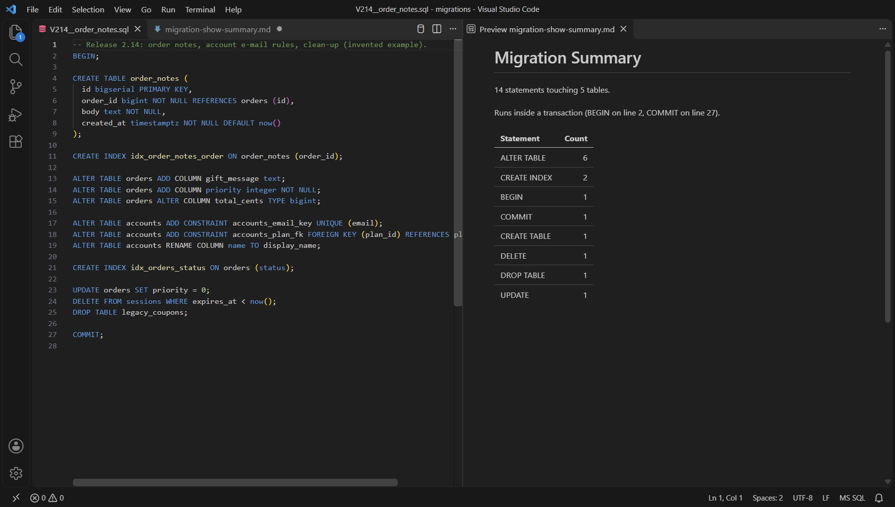
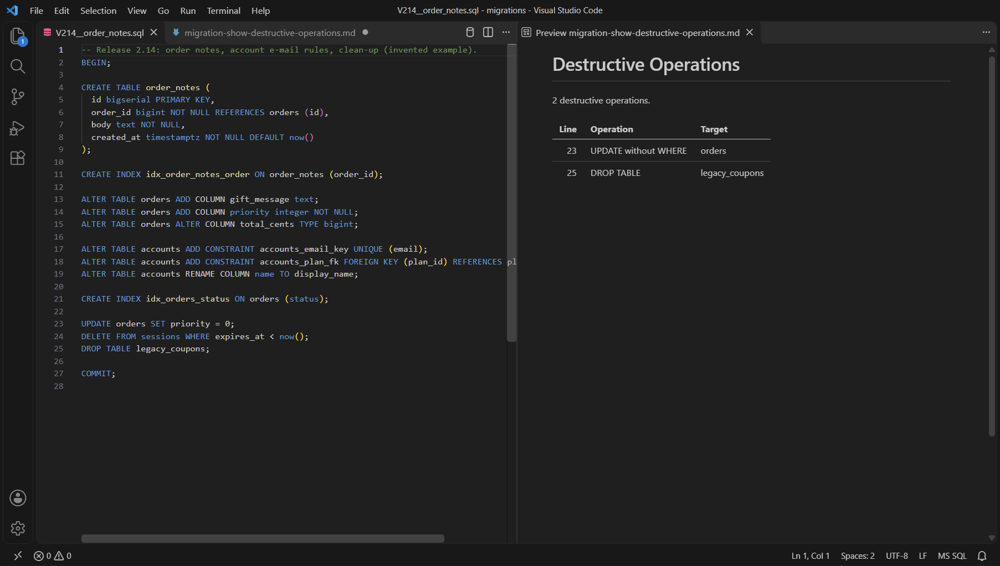
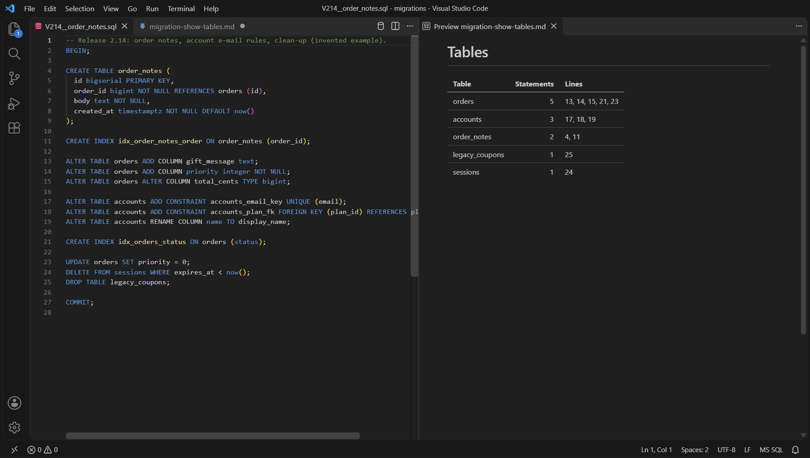
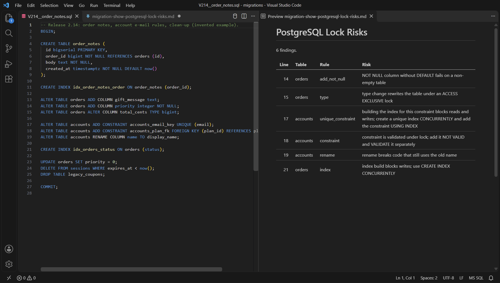
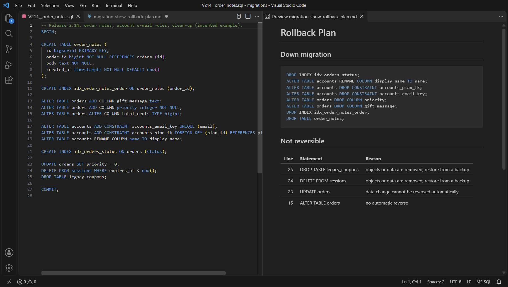

# Migration Atlas

Migration Atlas reads SQL migration files and turns them into clear Markdown reports before you run them: what the migration does and whether it runs in a transaction, the destructive operations (DROP, TRUNCATE, DELETE or UPDATE without WHERE, dropped columns and constraints), the tables it touches, the PostgreSQL operations that block reads or writes or rewrite a table, with the safer way to write them, and a rollback plan with a down migration for what can be reversed.

Everything runs on your computer. There is no telemetry. The only network request the extension ever makes is the licence check for the optional Pro tier (see [Privacy](PRIVACY.md)).

## What it does

* **Show Summary**: The migration at a glance: how many statements of each kind, how many tables, and whether it runs in a transaction.
* **Show Destructive Operations**: DROP, TRUNCATE, DELETE or UPDATE without WHERE, and dropped columns and constraints, with their lines.
* **Show Tables**: Every table the migration touches, with the number of statements and their lines.
* **Show PostgreSQL Lock Risks** (Pro): PostgreSQL operations that block reads or writes or rewrite a table, with the safer way to write them.
* **Show Rollback Plan** (Pro): A down migration for everything that can be reversed, and a list of what cannot.

## Free, trial and Pro

| Feature | Free | Pro |
| --- | :---: | :---: |
| Show Summary | yes | yes |
| Show Destructive Operations | yes | yes |
| Show Tables | yes | yes |
| Show PostgreSQL Lock Risks |  | yes |
| Show Rollback Plan |  | yes |
| Open Sample File, walkthrough, Report A Problem | yes | yes |

The free reports need no key, no account and no network connection, and they will not be moved behind the licence key later. The first Pro command starts a **free 14-day trial** on this computer. After that, Pro is a one-time purchase, not a subscription: **Pro Personal USD 19** (one person, use at work allowed) or **Pro Business USD 39 per user** (one key per user of an organisation). A key works on up to 3 computers. The checkout page shows the final price and any taxes for your country. Licence keys are sold by Dodo Payments, the merchant of record. Details: [licence](docs/licence.md), [terms](TERMS.md).

## Commands

Open the Command Palette and type `Migration Atlas`.

| Command | Tier |
| --- | :---: |
| Migration Atlas: Show Summary | Free |
| Migration Atlas: Show Destructive Operations | Free |
| Migration Atlas: Show Tables | Free |
| Migration Atlas: Show PostgreSQL Lock Risks | Pro |
| Migration Atlas: Show Rollback Plan | Pro |
| Migration Atlas: Open Sample File | Free |
| Migration Atlas: Open Walkthrough | Free |
| Migration Atlas: Show Documentation | Free |
| Migration Atlas: Report A Problem | Free |
| Migration Atlas: Buy Pro | Free |
| Migration Atlas: Enter Licence Key | Free |
| Migration Atlas: Show Licence Status | Free |
| Migration Atlas: Remove Licence From This Machine | Free |

## Settings

| Setting | Default | Meaning |
| --- | --- | --- |
| `migrationAtlas.maxFileSizeMB` | 50 | Largest file a report reads (0.1 to 50 MB; VS Code passes files only up to 50 MB to extensions). |
| `migrationAtlas.openReportsAsPreview` | true | Open each report in the Markdown preview as well. |

## FAQ

**Does Migration Atlas connect to my database?**
No. It reads the text of the open file only. Nothing is sent anywhere, and no database connection is made.

**Which databases does it support?**
The summary, destructive operations, tables and rollback plan work for any SQL migration; quoted names in double quotes or MySQL backticks are recognised. The lock-risk review and the SQL of the down migration follow PostgreSQL rules.

**Which lock risks does it find?**
Indexes built without CONCURRENTLY, CONCURRENTLY inside a transaction, foreign key and check constraints validated under lock, unique and primary key constraints that build their index under lock, SET NOT NULL, column type changes, volatile defaults and serial columns that rewrite a table, NOT NULL columns without a default, renames, and VACUUM FULL, CLUSTER and REINDEX without CONCURRENTLY. Tables created earlier in the same file are not checked, because they are still empty.

**Can I run the down migration as it is?**
It is a starting point: it reverses what can be reversed automatically, and lists the statements that cannot be reversed, such as dropped tables or deleted rows. Review it and test it on a copy of your data first.

## For IT and procurement

* Publisher: SmallStepsStudio (Visual Studio Marketplace), smallstepsstudio (Open VSX).
* Network: one host, `live.dodopayments.com`, for the licence check only, and only after a key is entered. No telemetry. The trial uses no network.
* Files are read from the editor only; the extension writes no files and changes none.
* Source: <https://github.com/small-steps-studio/migration-atlas>.
* Licence agreement: [LICENSE.txt](LICENSE.txt). Terms: [TERMS.md](TERMS.md). Privacy: [PRIVACY.md](PRIVACY.md).

## Support

Run **Migration Atlas: Report A Problem** or open an issue at <https://github.com/small-steps-studio/migration-atlas/issues>. Never post a licence key or confidential data in a public issue.

PostgreSQL is a trademark of the PostgreSQL Community Association of Canada; MySQL is a trademark of Oracle; Migration Atlas is an independent product and is not affiliated with or endorsed by either.
